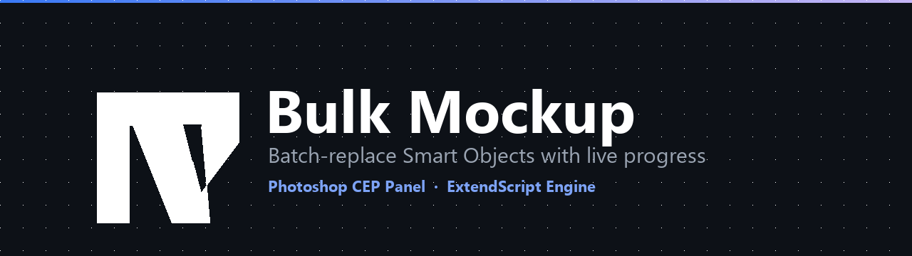

<p align="center">
  
</p>

<h1 align="center">Bulk Mockup</h1>

<p align="center">
  <em>Batch-replace a Photoshop Smart Object with every JPG/PNG in a folder — from a real panel, with live progress, cancellation and a report for every design.</em>
</p>

<p align="center">
  <a href="LICENSE"></a>
  
  
  
  
</p>

---

Bulk Mockup is the maintained successor to the one-file `bulkMockup .jsx` script. The idea is unchanged — point it at a mockup PSD, a folder of artwork and an output folder, and it produces one flattened mockup per design — but the surrounding plumbing has been rebuilt so it can be handed to someone who has never opened the ExtendScript Toolkit.

<p align="center">
  
</p>

## Table of contents

- [Why another version?](#why-another-version)
- [Features](#features)
- [Requirements](#requirements)
- [Install](#install)
- [Quick start](#quick-start)
- [Options](#options)
- [How it works](#how-it-works)
- [Upgrading from the legacy script](#upgrading-from-the-legacy-script)
- [Project layout](#project-layout)
- [Development](#development)
- [Troubleshooting](#troubleshooting)
- [Branding](#branding)
- [License](#license)

## Why another version?

The legacy script works, and it is a perfectly good 100 lines of ExtendScript. It is also unusable by anyone who did not write it:

| | `bulkMockup .jsx` | Bulk Mockup |
|---|---|---|
| Paths | Hard-coded `~/Desktop/...`, edited in a text editor | Four pickers in a panel |
| Target layer | `getByName("tst-music copy")` throws when absent | Falls back to the only Smart Object, or converts a plain layer |
| Feedback | Terminal silence until it finishes | Progress bar, per-file log, ETA, exported/failed counters |
| Failures | First bad file kills the run and leaves the PSD open | Per-design errors, run continues, CSV report |
| Cancelling | Kill Photoshop | Cancel button (between designs) |
| Clipboard | Copy/paste — clobbers your clipboard | Direct layer duplicate; clipboard only as a fallback |
| Output | Always JPEG quality 12, overwrites silently | JPEG or PNG, quality/compression, size cap, dedupe or overwrite |
| Fit | Contain only | Contain, cover, center, stretch, padding |
| Existing documents | Closes whatever it opened, including yours | Never closes a document it did not open, never saves over the mockup |

## Features

**Input**

- Visual pickers for the mockup PSD, the designs folder and the output folder; paths persist between sessions.
- `Find layers` lists every Smart Object in the mockup and fills the layer name for you.
- Natural sort (`design2` before `design10`), newest/oldest/largest order, name filter, start-at and limit for resuming a batch.
- Detects `.jpg`, `.jpeg`, `.png`, `.gif`, `.bmp`, `.tif`, `.tiff`, `.webp`, `.psd` and `.pdf`; anything else is reported as skipped rather than silently ignored.

**Replacement**

- `Auto` tries Photoshop's native *Replace Contents* first and falls back to editing the Smart Object when the mockup needs precise placement. Any non-default placement option (cover, center, padding or a background fill) automatically takes the precise route so the option is never silently ignored.
- `Edit contents` opens the Smart Object, duplicates the artwork in as a layer, fits and centres it, removes the previous artwork, and commits. The clipboard is only a fallback.
- Fit modes: fit/contain (letterbox), fill/cover (crop), center (native size, centred), stretch (legacy distortion). Optional padding as a percentage of the canvas.
- Optional transparency fill, so a JPEG of a PNG with a transparent background is not black.
- `Re-open the mockup for every design` for Smart Objects that misbehave when replaced repeatedly.

**Output**

- JPEG (quality 1–100, embedded colour profile, standard baseline) or PNG (compression 0–9, not interlaced).
- Long-edge cap that downsamples with bicubic sharper, plus automatic RGB/8-bit conversion for JPEG.
- File-name template with `{name}`, `{index}`, `{date}`, `{time}`, `{ext}`, plus optional prefix/suffix text (`prefix_name_suffix.ext`); illegal characters are stripped.
- Overwrite or keep-both (`track (2).jpg`).
- Optional `.log` file and per-design `.csv` report next to the outputs.

**Panel**

- Pre-flight validation before anything opens: missing mockup, empty designs folder, unwritable output, absent layer.
- Live status pill, progress bar, elapsed time, and a log you can copy or save for a bug report.
- Every run is wrapped in a `try`/`finally`: dialogs are restored, scratch documents are closed, and the mockup is never left dirty.
- Cancellation is a sentinel file, so it works even while ExtendScript is busy inside Photoshop.

## Requirements

| | |
|---|---|
| Photoshop | CC 2019 (v20) or newer — the manifest advertises 16.0+, but CEP 9 is the real minimum |
| OS | Windows 10/11 or macOS 11+ |
| CEP | 9 or newer (bundled with Photoshop CC 2019+); 11+ / 2022+ is the tuned target |
| Node.js | Only for the build/test scripts, **not** for running the panel. 18+ |

The host range in `CSXS/manifest.xml` starts at Photoshop 16.0 (CC 2015), but `RequiredRuntime` is CEP 9.0, so CC 2015–2018 (CEP 6–8) are skipped and the panel appears from **Photoshop CC 2019 (v20)** onward. CEP 9 and 10 use Chromium 61/74, which lack flexbox `gap`; the panel detects that and switches to a margin-based fallback, so it stays usable, though the layout is tuned for CEP 11+.

## Install

### One click (recommended)

**Windows**

1. Download or clone this project.
2. Double-click **`install.bat`**.
3. Restart Photoshop, then choose **Window → Extensions → Bulk Mockup**.

**macOS**

Open Terminal in the project folder and run:

```bash
bash install.sh
```

If you are not comfortable with Terminal: right-click the folder in Finder → **Services → New Terminal at Folder**, then paste that command. Do not use `sudo` — the panel belongs to your user profile.

That is the whole installation. The script copies the panel into your user profile, turns on the debug flag CEP requires for unsigned extensions, removes a stale non-debug copy, verifies the result, and prints the one remaining step: restart Photoshop. Administrator rights are not normally required; if Windows refuses a write, the installer asks for elevation itself and continues.

### What the installer changes

| | Windows | macOS |
|---|---|---|
| Panel folder | `%APPDATA%\Adobe\CEP\extensions\com.bulkmockup.panel.debug` | `~/Library/Application Support/Adobe/CEP/extensions/com.bulkmockup.panel.debug` |
| Files | copies only what the panel needs (`tools/`, `docs/` and `.git` stay out) | same |
| Debug mode | `PlayerDebugMode = 1` for `CSXS.9`–`CSXS.16`, current user | `defaults write com.adobe.CSXS.{9..16} PlayerDebugMode 1` |
| Old copies | removes a stale `com.bulkmockup.panel` folder | same |
| Re-running | replaces the previous installation | same |

The `.debug` suffix is deliberate: CEP only reads the bundled `.debug` file — the DevTools port on 8088 — when the extension folder ends that way. The manifest's bundle id stays `com.bulkmockup.panel`, and CEP strips the suffix for identity, so the panel appears once.

Nothing else is touched. To uninstall, delete that folder and those registry values / defaults — steps are in [`docs/INSTALL.md`](docs/INSTALL.md).

### Developer mode (`--link`)

`install.bat --link` or `bash install.sh --link` links instead of copying, so edits in this folder appear after the panel is reloaded. Windows uses a junction (no admin needed), macOS a symlink. Both modes install to the same `.debug` folder; the flag only chooses copy versus link. Leave it off for a normal install: a copy keeps working even if you later move this folder.

### Other ways to install

- **Manual, step by step** — [`docs/INSTALL.md`](docs/INSTALL.md) has the by-hand route, CEP log locations and remote debugging.
- **Signed ZXP for distribution** — `npm run pack`, then ZXPInstaller. A ZXP installs the plain `com.bulkmockup.panel` folder, which the one-click installer replaces; uninstall it with `ExManCmd` first. See [`docs/INSTALL.md`](docs/INSTALL.md#3-signed-zxp-distribution).
- **Without any extension** — run `jsx/standalone/BulkMockupStandalone.jsx` from **File → Scripts → Browse…**.

## Quick start

1. Open the panel and pick your **mockup PSD**.
2. Press **Find layers**, then click the Smart Object in the list (or type its name). The legacy default, `tst-music copy`, is pre-filled if nothing is chosen.
3. Pick the folder of **designs** — the count and skipped files appear immediately.
4. Pick an **output** folder. It is created on the first run if it does not exist.
5. Press **Validate**. When every line is green, press **Start batch**.

Leave the mockup PSD open or closed. The engine opens the file, never saves over it, and closes it only if it was the one that opened it; your other documents are untouched.

## Options

Everything lives under the **Options** disclosure. Defaults preserve the original script's contain-and-centre behaviour; output quality is now expressed as 85% and the fit mode defaults to `contain`.

| Option | Default | Notes |
|---|---|---|
| Fit | `contain` | `cover` crops to fill; `center` keeps the native pixel size; `stretch` (legacy) distorts. Ignored by *Replace contents*. |
| Replace using | `auto` | `auto` uses fast replace for the default fit, precise edit for any non-default fit/padding/fill, and falls back when replace fails. |
| Padding | `0%` | Inset from every edge, as a % of the Smart Object canvas (0–20 in the UI, capped at 45 internally). Ignored by `center`. |
| Format | `JPEG` | PNG keeps transparency (fill it explicitly if you want a backdrop). |
| Max long edge | `0` (= native) | Downsample with bicubic sharper rather than upscaling. |
| JPEG quality | `85%` | 1–100; mapped to Photoshop's 0–12 scale (100 = maximum). |
| PNG compression | `6` | 9 is smallest and slowest. |
| File name template | `{name}` | Tokens: `{name}` `{index}` `{date}` `{time}` `{ext}`. |
| Filename prefix | — | Added before the template with an underscore, e.g. `client_track.jpg`. |
| Filename suffix | — | Added after the template with an underscore, e.g. `track_final.jpg`. |
| Fill transparent areas | off | Hex colour (`#ffffff` or `fff`); applied inside the Smart Object. |
| Order | Name (natural) | Also reverse, newest/oldest first, largest first. |
| Name contains | — | Case-insensitive substring filter. |
| Start at # / Limit | `1` / `0` | 1-based; `limit 0` means everything. |
| Re-open mockup per design | off | Slower, but avoids Smart Objects that drift across repeated replaces. |
| Pause between designs | `0 ms` | Gives Photoshop a moment to redraw. |
| Log level | `info` | `debug` adds per-step detail to the panel log. |
| Write `.log` / `.csv` | on / on | Same folder as the outputs, timestamped. |

## How it works

```
┌─────────────────────────── CEP panel (Chromium) ───────────────────────────┐
│  index.html → app.js → bridge.js ──CSInterface.evalScript──┐               │
│       ↑                                                    │               │
│       └──── CSXSEvent "com.bulkmockup.event" ◄─────────────┘               │
└────────────────────────────────────────────────────────────────────────────┘
                                     │
┌──────────────────────── ExtendScript engine (Photoshop) ───────────────────┐
│  api.jsx → batchRunner.jsx → fileSystem · photoshop · smartObject          │
│                                     · placement · exporter                 │
└────────────────────────────────────────────────────────────────────────────┘
```

- Every call returns a JSON envelope, `{ok: true, data}` or `{ok: false, error}`, so a thrown ExtendScript error never surfaces as the opaque *"EvalScript error."*.
- Progress is pushed through a single `CSXSEvent` channel; the payload carries its own `type` (`log`, `progress`, `item`, `done`).
- Cancellation is a sentinel file in the temp directory: the panel creates it, the running batch checks it between designs, and the next run clears it. ExtendScript is single-threaded, so a second `evalScript` could not interrupt a busy batch — a file can.
- The mockup PSD is treated as read-only input. Export happens on a duplicate; only the duplicate is closed.

[`docs/ARCHITECTURE.md`](docs/ARCHITECTURE.md) has the module map, config schema, error codes, event protocol and the two replacement strategies in detail.

## Upgrading from the legacy script

Your existing mockup PSD needs no changes: the default layer name is still `tst-music copy`, and the default fit is still contain-and-centre.

What changes in behaviour, and why:

- **Existing outputs are overwritten by default**, exactly like the old `saveAs`. Untick *Overwrite existing files* to keep both (`track (2).jpg`).
- **Nothing is left open.** The old script closed the mockup at the end of each iteration; the new one closes only the documents it opened, in a `finally`.
- **A missing layer no longer aborts silently.** You get a dialog naming the layer, with a hint pointing at **Find layers**, instead of a script that just stops.
- **The clipboard is untouched in normal use.** The artwork is duplicated in as a layer, and old artwork is removed by layer id rather than by "delete the bottom layer", which was only correct for two-layer Smart Objects.
- **Two extra files per run** (`.log` and `.csv`) unless you turn them off. They land next to the outputs, not on the Desktop.

If you only want the old behaviour, use the standalone script with default answers — it prompts instead of reading hard-coded paths.

## Project layout

```
bulk-mockup-plugin/
├── install.bat                    one-click Windows installer
├── install.sh                     one-click macOS installer
├── CSXS/manifest.xml              CEP manifest (identity, host range, panel size)
├── client/                        the panel: no framework, no build step
│   ├── index.html                 every control and its id
│   ├── css/panel.css              dark UI, flexbox `gap` + CEP 9/10 margin fallback
│   ├── js/bridge.js               evalScript wrapper, JSON envelopes, event listener
│   ├── js/store.js                persisted settings + defaults
│   ├── js/ui.js                   toasts, modal, log rendering, progress
│   ├── js/pickers.js              file/folder pickers, layer list
│   ├── js/app.js                  the controller: validate → run → report
│   └── lib/CSInterface.js         vendored Adobe library (npm run vendor:csinterface)
├── jsx/                           ExtendScript engine, ES3 only
│   ├── index.jsx                  #include source tree (development entry)
│   ├── engine.jsx                 generated flattened entry (manifest ScriptPath)
│   ├── api.jsx                    public JSON API + runInteractive()
│   ├── core/                      constants, errors, utils, CEP events, logger
│   ├── modules/                   fileSystem, photoshop, smartObject, placement, exporter
│   ├── services/batchRunner.jsx    normalize → inspect → run, progress + cancel
│   └── standalone/                generated single-file script for File > Scripts
├── assets/                        logo, icon, banner, wordmark
├── docs/                          INSTALL, ARCHITECTURE, UXP-MIGRATION
└── tools/                         build, tests, preview, packaging, logo generator
```

## Development

There are no runtime dependencies. Node is only used for the tooling.

```bash
npm test              # 17 headless engine tests (real JSX in a vm against fake File/Folder/app)
npm run check:panel   # every $('id') resolves; scripts exist; no stray console.log
npm run build         # regenerate jsx/standalone/BulkMockupStandalone.jsx
npm run verify        # check:panel + test + build  (the gate before a release)
npm run preview       # serve a browser preview of the panel with a mock CEP runtime
npm run preview:shot  # flat, single-page copy of the panel for screenshots
npm run brand         # regenerate every logo/banner from tools/make_logo.py
npm run pack          # stage + sign a .zxp (needs ZXPSignCmd and a .p12)
```

The tests are worth a note: they load the *real* `.jsx` sources into a Node `vm` (with the `#include` lines inlined) against a stand-in `File`, `Folder` and `app`. That catches path normalisation, config coercion, natural sorting, naming templates, deduplication and pre-flight validation without launching Photoshop. Anything that needs a real document — layer resolution, Smart Object replacement, export — is covered by the manual checklist in [`docs/ARCHITECTURE.md`](docs/ARCHITECTURE.md#manual-test-checklist).

The preview harness (`tools/preview/`) serves the repo root over HTTP, replaces `CSInterface` with `tools/preview/mock-cep.js`, and renders the actual `client/index.html` in an iframe. It is how the panel was developed without restarting Photoshop: `__populate()` fills the form, `__stream()` simulates a running batch.

ExtendScript is ES3. Inside `jsx/` you cannot use `let`/`const`, arrow functions, template literals, `Array.prototype.forEach/map/filter`, or `Object.keys`. The panel (`client/`) is ordinary modern Chromium JavaScript.

## Troubleshooting

| Symptom | Cause and fix |
|---|---|
| **Window → Extensions** has no *Bulk Mockup* | `CSXS/manifest.xml` is not under a folder in the extensions directory, debug mode is off, two `com.bulkmockup.panel*` folders exist, or Photoshop needs a full restart. Check the CEP log: `%APPDATA%\Adobe\CEP\logs\` (Windows) or `~/Library/Logs/CSXS/` (macOS). |
| Panel loads but is blank | The installer's `.debug` folder enables the DevTools port (8088); inspect `http://localhost:8088`. Usually a syntax error in `client/js/*`. |
| “Photoshop could not be reached” | The engine did not load. The panel retries by evaluating `jsx/engine.jsx` itself; if that fails, the message includes the ExtendScript error. |
| “The Smart Object layer was not found” | Press **Find layers**. Names are exact and case-sensitive; `tst-music copy` is only the fallback. |
| “That layer exists but is not a Smart Object” | Enable *Convert a matching plain layer into a Smart Object*, or re-create the Smart Object in the mockup. |
| JPEG output is white where the design is transparent | Enable *Fill transparent areas* and pick a colour, or export PNG. |
| *Cancel* seems slow | Cancellation is checked between designs, not mid-export. Long single exports finish first. |
| Batch is slow | Leave *Re-open mockup per design* off, and avoid *Edit contents* when *Replace contents* works. Both are per-run settings. |
| A Smart Object stops updating partway through a long batch | Turn on *Re-open the mockup for every design*; some mockups with linked Smart Objects need it. |

For a bug report, use **Save panel log** in the panel and attach the `.log`/`.csv` from the output folder. The engine's log level `debug` records every step.

## Branding

`assets/logo.png` is a placeholder rendition of the geometric “M” mark, generated procedurally by [`tools/make_logo.py`](tools/make_logo.py) (Pillow). Nothing in the code depends on it, so replacing it is a straight file swap:

- `assets/logo.png` — 512×512, transparent, used in the panel header and this README
- `assets/logo-light.png` — same mark on light backgrounds
- `assets/icon.png` — panel icon (referenced by `manifest.xml`)
- `assets/logo.svg` — vector version for print/docs
- `assets/banner.png` — 1280×360 README hero

Drop in your official export with the same names and sizes, or edit the geometry constants at the top of `make_logo.py` and run `npm run brand`.

## License

[MIT](LICENSE) — use it, fork it, ship it. The vendored `client/lib/CSInterface.js` is Adobe's, under Adobe's own terms.
